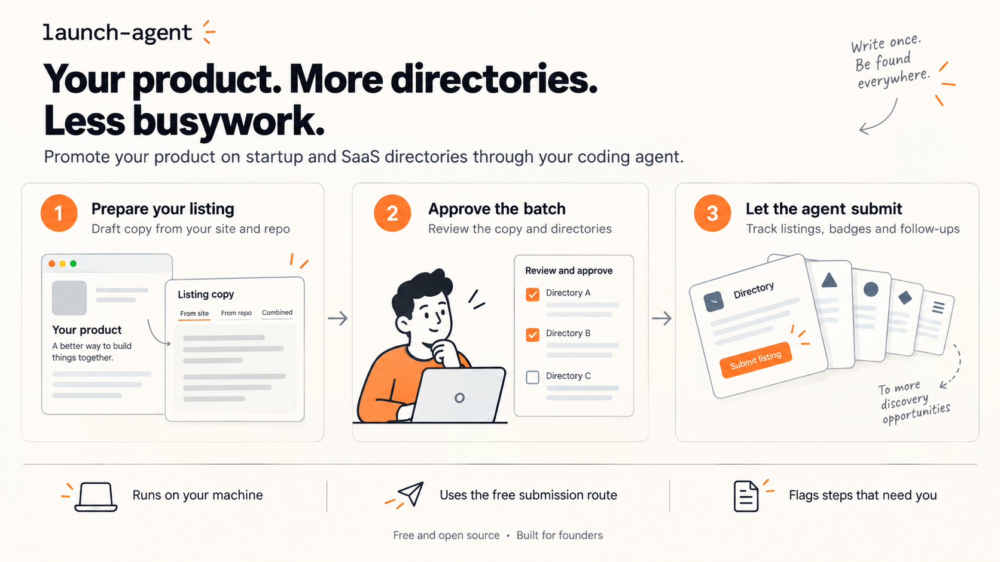
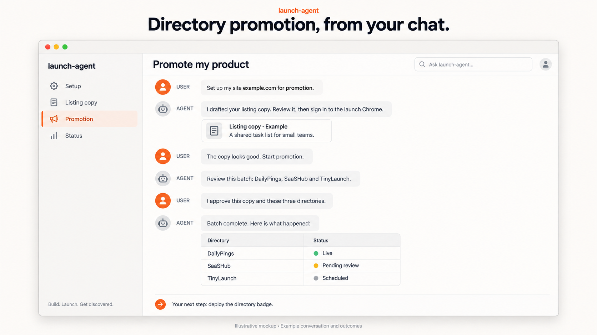

# launch-agent

**Let your coding agent handle directory submissions. Get back to building.**

You built the product. Now getting it listed means researching directories, writing pitches,
creating accounts, pasting the same description into different forms, and keeping track of what
happened. If you're short on time and don't enjoy marketing, it's easy to keep putting it off.

launch-agent takes on those chores. Talk to it in Claude Code, Codex or OpenCode: it drafts your
listing copy, proposes suitable directories, and submits through Chrome after you approve the copy
and the batch. You get a progress report and the specific steps that still need you.

Free and open source (MIT), running on your machine. Submission runs use your coding agent's
account or provider. **[Get started](#quick-start)** or [watch the explainer](get-it-listed.mp4).



## The marketing chores it takes off your plate

- **Write your listing copy once.** Your chat agent drafts taglines, descriptions, categories,
  tags and a launch comment from your site, repo and answers. It prepares different lengths for
  different forms, so you review one copy bank instead of rewriting your pitch for every directory.
- **Choose where to submit.** Start with a shortlist from 73 directory playbooks, filtered by
  your product's fit and requirements. Equally fitting directories prioritize known free dofollow
  opportunities. Badge requirements, long queues and conditional link offers are shown before you
  approve, so you can decide whether they're worth the effort.
- **Delegate the repetitive forms.** The submission agent signs in with Google, fills fields
  with approved copy, uploads your approved logo and screenshots, and follows the free route.
  It declines paid upgrades and reports directories where no free route is available.
- **Collect badges in one place.** When a directory requires a backlink badge, launch-agent
  collects it into one HTML, JSON or TypeScript file for your site. Once you publish that file,
  the next pass checks the badge is live and returns to finish the directory's verification.
- **Pick up where you left off.** Progress is saved per product. Ask "what's the status?" for
  submitted, queued, scheduled and live listings, plus an actionable "Needs you" list with the
  step and link. After you handle a code, CAPTCHA or other handoff, tell the agent to continue.
- **See which links actually went live.** It checks listing pages from a logged-out browser,
  verifies they link to your product, and reports dofollow/nofollow status and page indexing
  restrictions. Pending reviews and scheduled launches stay visible in the tracker.

You review the words and destinations, sign in, and handle the occasional human-only step.
The agent handles the repeat work between those decisions.

## How it works

After [setup](#quick-start), talk to your coding agent:

1. **"Set up my site myproduct.com for promotion."** Point it at your product's repo, or answer a
   few questions. It drafts your taglines, descriptions, launch comment, categories and tags from
   your code and site, and goes through them with you until they read right.
2. **"Start promotion."** You sign a dedicated Chrome profile into your launch Google account, once.
3. **Approve a batch.** It proposes the best-fit directories. Cut any you don't want and approve
   the rest.
4. **Let it work.** It submits a few at a time and reports the results. Publish any collected
   badges and handle the steps marked "Needs you", then ask it to continue.

Runs are started on demand, and your computer must stay awake while they work. Later, say
**"Promote on more directories"** or **"Focus on dofollow opportunities"** to choose the next batch.



*Illustrative mockup with an example conversation and outcomes.*

## Quick start

You need:

- **macOS, Chrome and Node.js 20+.** Other operating systems are untested.
- **Claude Code, Codex or OpenCode** for the chat workflow.
- **Claude Code or OpenCode installed for submissions**, even if you chat in Codex. Runs use that
  tool's account or provider.
- **A Google account for launches.** A dedicated account keeps directory emails out of your main inbox.

```bash
git clone https://github.com/apsquared/launch-agent.git && cd launch-agent
npm install
```

Then open your coding agent in that folder and say: **"Set up my site myproduct.com for
promotion."**

**[HOW_TO.md](HOW_TO.md) has the full walkthrough**, including badges, agent backends and running
the commands yourself.

## You stay in control

- **You approve the copy and each directory batch in chat.** Changes to copy, assets or directory
  instructions require approval again before that batch can run.
- **Submissions use a separate, restricted agent.** It can use only the guarded browser tools,
  approved listing values and allowed sites. See [How it stays safe](HOW_TO.md#how-it-stays-safe).
- **No purchases.** Paid-only routes are reported for your decision.
- **Passwords, emailed codes and CAPTCHAs stay with you.** The agent pauses with an explanation
  when a directory needs a person.
- **Your product data stays in a local, gitignored workspace.** Each product has its own copy,
  assets and submission history.

launch-agent is for listing your own product through directories' normal free routes.
Founder-led launches such as Product Hunt and Show HN stay with you.

## 73 directory playbooks

The catalog includes SaaSHub, AlternativeTo, Uneed, TinyLaunch, Startup Fame, Peerlist Launchpad
and more, with sign-in, free-route and badge instructions. It also covers directories specifically
for open-source projects and MCP servers; those are proposed only after you confirm eligibility.
Some entries require manual submission. See [the full catalog](HOW_TO.md#directories).

For a dofollow-only shortlist, ask your agent or use `npm run batch:propose -- --link dofollow`.
Some offers require a deployed badge or a minimum product domain rating; ranking rewards are
conditional. The actual link is checked after publication.

## What happened in the first run

[BuyerCue](https://www.buyercue.io) went to 17 directories in three days. At that checkpoint:

- **14 submitted:** four confirmed live, with the rest scheduled, queued or in review.
- **$0 in listing fees:** paid-only directories were reported, not bought.
- **Three steps needed a person:** an emailed sign-in code, a launch-date booking and one badge check.

| Outcome | Directories |
|---|---|
| Live, confirmed from a logged-out browser | DailyPings, Findly.tools, Startup Fame, Uno Directory |
| Launch scheduled | IndieHunt, Nick Launches, TinyLaunch |
| In the free queue | Huzzler, LaunchNest, PeerPush |
| Pending review | AlternativeTo, PitchWall, SaaSHub, ToolDirs |
| Not submitted | Uneed (already listed), LaunchBoard (free slots full that week; reported as paid-only, nothing bought), SaaSworthy (skipped: emailed code plus a bot check) |

> **Status:** early. Used in production for one product so far, on macOS. Expect rough edges, and
> expect directories to change their forms under you.

## Contributing

Know a directory that's missing, or did one change its form? Directory playbooks are the most
useful contribution. [CONTRIBUTING.md](CONTRIBUTING.md) explains the playbook format, how to share
what your runs learned, and the rules for code changes. Security problems go through
[private reporting](SECURITY.md).

## Also from the maker

launch-agent manages directory promotion for [BuyerCue](https://www.buyercue.io) and
[Idea Launch](https://www.idea-launch.io). If you're a founder, they might help you too:

- **[BuyerCue](https://www.buyercue.io):** find SaaS companies that already pay for growth, with
  sourced, dated evidence and a public way to reach them.
- **[Idea Launch](https://www.idea-launch.io):** find out whether people want your idea with real
  ads on Facebook, Instagram or Reddit, before you build it. No ad account needed, and ad costs are
  included.

## License

[MIT](LICENSE)
